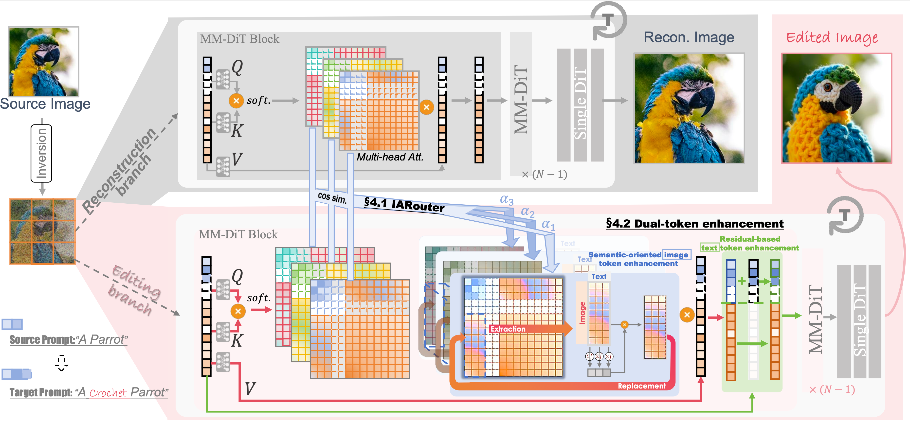

# HeadRouter: A Training-free Image Editing Framework for MM-DiTs by Adaptively Routing Attention Heads


<a href='https://yuci-gpt.github.io/headrouter/'></a>
<a href='https://dl.acm.org/doi/10.1145/3797956'></a>
<a href='https://arxiv.org/abs/2411.15034'></a> 
</div>


## TL; DR
HeadRouter is a training-free text guided real image editing framework that based on MM-DiT (e.g. SD3 and Flux).

## Abstract
Diffusion Transformers (DiTs) have exhibited robust capabilities in image generation tasks. However, accurate text-guided image editing for multimodal DiTs (MM-DiTs) still poses a significant challenge. Unlike UNet-based structures that could utilize self/cross-attention maps for semantic editing, MM-DiTs inherently lack support for explicit and consistent incorporated text guidance, resulting in semantic misalignment between the edited results and texts. In this study, we disclose the sensitivity of different attention heads to different image semantics within MM-DiTs and introduce HeadRouter, a training-free image editing framework that edits the source image by adaptively routing the text guidance to different attention heads in MM-DiTs. Furthermore, we present a dual-token refinement module to refine text/image token representations for precise semantic guidance and accurate region expression. Experimental results on multiple benchmarks demonstrate HeadRouter's performance in terms of editing fidelity and image quality.


## Installation & Usage

1. **Clone the repository and set up the environment.** The code is tested with the conda environment `diffusers0.18.0` (Python 3.10, PyTorch 2.1 + CUDA 12.1). You must install the **local** patched `diffusers` in this repo — stock Hugging Face `diffusers` does not include the HeadRouter modifications.

   ```bash
   git clone https://github.com/ICTMCG/HeadRouter.git
   cd HeadRouter

   # Option A: recreate the conda environment
   conda env create -f environment.yml
   conda activate diffusers0.18.0

   # Option B: use your own environment
   # pip install -r requirements.txt

   # Install the patched local diffusers (required)
   pip install -e ./diffusers
   ```

2. **Prepare the FLUX.1-dev weights** (via a Hugging Face login, or point to a local checkpoint):

   ```bash
   huggingface-cli login
   # or pass a local path at run time: --model /path/to/FLUX.1-dev
   ```

3. **Run inference.** Use the provided example script:

   ```bash
   bash scripts/infer_tree2.sh
   ```

   or call `main.py` directly:

   ```bash
   python main.py \
     --image examples/images/tree2.png \
     --eta 0.9 \
     --gamma 0.5 \
     --start_timestep 0 \
     --stop_timestep 8 \
     --prompt_list "A tree" "A tree with lightning and the Moon"
   ```

   `--prompt_list` takes `[source_prompt, target_prompt]`, and results are saved under `outputs/<image_stem>/`.

> **Important Note on Hyper-parameters:**
> Please note that training-free image editing relies heavily on hyper-parameter tuning. You will need to adjust the hyper-parameters based on the specific input image and the type of editing you want to perform.

> **Tips:**
> The larger the --eta value, the closer the edited result will be to the original image.

Below is our recommended hyper-parameter configuration for various inversion and editing tasks:

**Hyper-parameter configuration of our method for inversion and editing tasks**

| Task | Starting Time | Stopping Time | Strength |
| :--- | :---: | :---: | :---: |
| Object insert | 0 | 6 | 1.0 |
| Gender editing | 0 | 8 | 1.0 |
| Age editing | 0 | 5 | 1.0 |
| Adding glasses | 6 | 25 | 0.7 |
| Stylization | 0 | 6 | 0.9 |

*(Note: Stopping Time and Strength are parameters for Controller Guidance)*

## Citation

If you find this work useful, please consider citing:

```bibtex
@article{xu2024headrouter,
  title={Headrouter: A training-free image editing framework for mm-dits by adaptively routing attention heads},
  author={Xu, Yu and Tang, Fan and Cao, Juan and Kong, Xiaoyu and Zhang, Yuxin and Li, Jintao and Deussen, Oliver and Lee, Tong-Yee},
  journal={ACM Transactions on Graphics},
  publisher={ACM New York, NY}
}
```

## Acknowledgements

This work is built upon several excellent open-source projects and research efforts. We sincerely thank the authors and contributors for making their work publicly available and for advancing the community:

- **Diffusers**  
  https://github.com/huggingface/diffusers
  
- **RF-Inversion**  
  https://github.com/LituRout/RF-Inversion


## Pipeline


## Comparison with baselines


## More of our results


